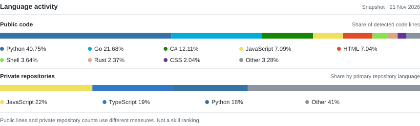

# BreezeDelegate

I build and operate Linux services, backend tools and game-server infrastructure. My work ranges from Docker Compose preflight checks to production troubleshooting, APIs and automation.

I also contribute fixes upstream: interval scheduling in Tokio, Unicode content search in Linux Mint's Nemo, and better game-server monitoring in LinuxGSM. I care about fixing the underlying problem and leaving useful tests behind.

## Languages

  
  
  
  
  
  
  
  
  
  
  
  
  
  
  
  

## Frameworks & platforms

  
  
  
  
  
  
  
  
  
  

## Infrastructure & tools

  
  
  
  
  
  
  
  
  
  
  
  
  
  
  

  
  
  
  
  

<picture>
  <source media="(max-width: 600px) and (prefers-color-scheme: dark)" srcset="./assets/language-footprint-mobile-dark.svg">
  <source media="(max-width: 600px)" srcset="./assets/language-footprint-mobile-light.svg">
  <source media="(prefers-color-scheme: dark)" srcset="./assets/language-footprint-dark.svg">
  
</picture>

Public and private distributions use different measures. These figures describe repository content, not proficiency.

## Current projects

### [BeforeUp](https://github.com/BreezeDelegate/beforeup)

A read-only Linux CLI for checking Docker Compose projects before deployment. It flags host port conflicts and missing bind-mount paths, and can compare planned changes with running containers.

### [Wisp MCP](https://github.com/BreezeDelegate/wisp-mcp)

A Python integration for MCP-compatible clients working with WISP game panels. It covers server resources, files, console commands, backups and databases, with permission controls for sensitive actions. The code is public under the PolyForm Noncommercial license.

## Upstream contributions

Selected changes merged into independent upstream projects:

- **[Tokio #8385](https://github.com/tokio-rs/tokio/pull/8385)** · Rust - fixed interval deadline overflow for extreme durations, including tests for reset and missed-tick strategies.
- **[Nemo (Linux Mint) #3829](https://github.com/linuxmint/nemo/pull/3829)** · C - restored Unicode content search and added a regression test for combining characters.
- **[LinuxGSM #5111](https://github.com/GameServerManagers/LinuxGSM/pull/5111)** · Shell - improved failed game-server health checks with local listener and port diagnostics.
- **[tower-http #728](https://github.com/tower-rs/tower-http/pull/728)** · Rust - made directory trailing-slash redirects configurable while preserving existing defaults.
- **[River #1359](https://github.com/riverqueue/river/pull/1359)** · Go - prevented recurring jobs from advancing their schedule after failed batch insertion, with regression coverage.

## Open source and collaboration

I'm interested in good ideas, especially when there's a difficult technical problem to untangle. I'm happy to review an approach, share a second opinion or contribute a fix to a project I find worthwhile, even when there's no paid work involved.

For infrastructure work, backend integrations or agency subcontracting, find me at **[vitrine.bar](https://vitrine.bar/)**.

GitHub activity

